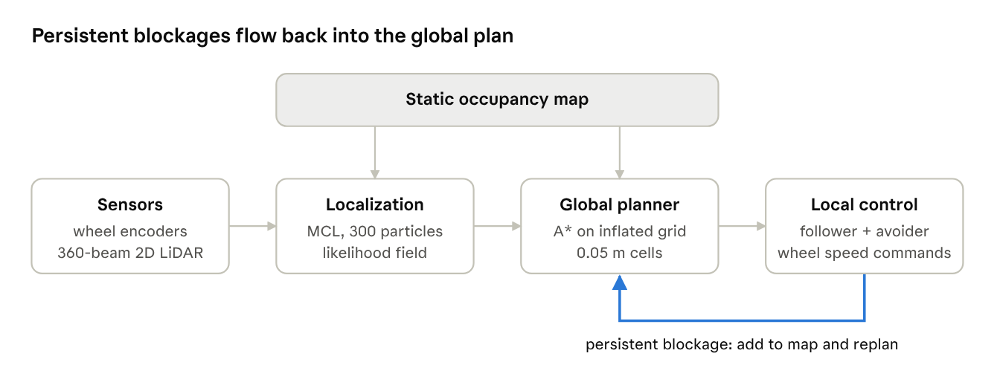

# CMPE 185 Final Report: Autonomous Indoor Delivery

> Snapshot of the working draft, 25 Nov 2026. The live, editable copy is the
> team's Claude Doc (link in `docs/report_instructions.md`); edit there and
> refresh this file before submission. Items marked *To fill* or *To confirm*
> are open. Finishing steps: `docs/report_instructions.md`.

**Group 5 (Tron):** Mateo Ortega, Zihao He, Devin Roberson
**Course:** CMPE 185 Autonomous Mobile Robots, San José State University, Fall 2026 (Dr. Wencen Wu)
**Code, data and videos:** [github.com/Norsedude/Autonomous-Indoor-Delivery](https://github.com/Norsedude/Autonomous-Indoor-Delivery)

## Abstract

Our e-puck completes the HOME, A, B, C, HOME delivery mission in every nominal, uncertain-start and blocked-route trial (15/15), where the provided odometry-only baseline completes none (0/15). The robot uses only wheel encoders, a 2D LiDAR and a static occupancy map. It localizes with Monte Carlo Localization (a particle filter with a likelihood-field LiDAR model), plans with A\* on a clearance-inflated grid, and avoids unmapped obstacles with a reactive layer that feeds persistent blockages back to the planner for replanning. In 120 headless Webots runs logged by the evaluation Supervisor, position RMSE fell from 0.107 m (baseline) to 0.030 m in the nominal scenario. The system also succeeded 10/10 on two obstacle placements it was never tuned for. Kidnapped-robot recovery succeeded in 2/5 trials; we show that the remaining failures come from the map's 180-degree rotational symmetry, which makes two poses produce identical scans. Our extension, a robust sensing layer for degraded LiDAR, raised mission success under severe dropout and noise from 0/5 to 4/5 on the nominal route and from 4/5 to 5/5 on the blocked route, with no cost when the sensor is healthy.

## 1. Introduction and problem statement

The task is an indoor delivery mission in a simulated four-room building: start near HOME, visit A, B and C in that order, and return HOME. The robot is a Webots R2025a e-puck2 with wheel radius 0.0200 m, a calibrated effective track width of 0.0574 m, a collision radius of 0.037 m and a 360-beam 2D LiDAR. Goal positions are HOME (-3.2, -2.2), A (-3.2, 2.2), B (1.3, 2.2) and C (3.2, -2.2) m; a goal counts when the ground-truth pose passes within 0.20 m of it.

The controller may use only wheel encoder angles, the LiDAR point cloud, the static occupancy map, the destination sequence and robot parameters. GPS, ground-truth pose, Supervisor API calls and the evaluation log are prohibited. The evaluation Supervisor records ground truth, counts collisions, moves an unmapped red obstacle and can relocate the robot, but never sends pose information to the controller.

Four required scenarios test the system:

| Scenario | Test condition | What it reveals |
| --- | --- | --- |
| Nominal | Known start region, standard noise, blocker at position 1 | End-to-end performance |
| Uncertain start | Initial belief covers the whole HOME room, unknown heading | Global localization |
| Blocked route | Blocker moved to position 2 (west corridor) after planning | Avoidance and replanning |
| Kidnapped robot | Robot moved to (0.9, -2.1, π) at t = 150 s | Belief recovery |

The core difficulty is that encoder odometry drifts. The provided baseline follows 23 fixed waypoints on odometry alone and, in Webots, its estimate drifts by about 0.17 m over the route, enough to miss goal C. The robot must instead use the LiDAR to stay localized, plan its own routes, and keep moving when the map is wrong or when it is moved.

## 2. Related work

*To confirm before submission: every member should skim each paper below, keep only those you can stand behind, and check that at least three are outside the class readings.*

**Monte Carlo Localization.** Dellaert et al. [1] and Fox et al. [2] introduced particle-filter localization for mobile robots, representing the belief by weighted samples so that multimodal and global uncertainty can be tracked, unlike a Kalman filter. Our filter follows this predict, weight, resample cycle. Thrun et al. [3] showed that plain MCL degrades when the belief has collapsed onto the wrong pose and proposed mixing in samples drawn from the measurement; our global scan-matching recovery serves the same purpose. Lenser and Veloso [4] proposed sensor-resetting localization, which reseeds particles when measurements become unlikely; our inlier-ratio kidnap trigger is in this spirit.

**Measurement model and resampling.** The likelihood-field model, the effective sample size test and low-variance resampling we use are described in Thrun, Burgard and Fox [5]. Fox [6] adapts the number of particles to the belief's spread (KLD-sampling); we keep a fixed 300 particles and use separate 100-particle filters per hypothesis after a kidnap.

**Planning and avoidance.** A\* [7] finds the minimum-cost path on a graph with an admissible heuristic; we run it on an 8-connected grid with an octile heuristic and a clearance cost. Incremental planners such as D\* Lite [8] reuse earlier search effort when the map changes; we simply replan from scratch on our 0.05 m grid. Local reactive methods such as the vector field histogram [9] and the dynamic window approach [10] steer around nearby obstacles in real time; our reactive avoider is simpler and, unlike a purely local method, reports persistent blockages back to the global planner.

## 3. System overview

Every control step runs the same pipeline, shared by the Webots controller and our offline simulator through one `MissionController` class (`mission.py`); `project_starter.py` only reads the devices, drives the motors and draws the robot's display.



Encoders and LiDAR feed the particle filter; A\* plans from the estimated pose to the next goal on the static map plus LiDAR-detected obstacles; the follower and reactive avoider turn the path into wheel speeds. When the avoider stays blocked, it writes the obstacle into the planning map and A\* replans.

**Mission state machine.** `localize`, then `plan`, then `follow` the path to each goal in turn until `complete`; plus `relocalize` (turn in place for 6 s after a kidnap), `no_path` and `waiting_for_plan`. A goal counts only when localization is confident. While several pose hypotheses remain, an arrival counts as tentative and the robot continues; every leg of this mission crosses the central corridor, which separates the hypotheses. If localization becomes confident again after a tentative arrival, the mission resumes from the first tentative goal.

## 4. Localization: Monte Carlo Localization

The pose x = (x, y, θ) is estimated by a particle filter with N = 300 particles (`localization.py`). A filter update runs after 2 cm or 0.05 rad of motion, or every 12 control steps; between updates the estimate is propagated with odometry.

**Initial belief.** Nominal: particles drawn from a Gaussian around the configured start with σ = 0.45 m in position and 0.50 rad in heading, rejecting occupied cells. Uncertain start: the belief is uniform over the HOME room with unknown heading, realized by the global scan-matching search described below, restricted to that room.

**Motion model.** Each particle is moved by the odometry increment (Δd, Δθ) since the last update, expressed in the robot frame, plus zero-mean Gaussian noise:

```latex
\sigma_d = 0.08\,|\Delta d| + 0.01\,|\Delta\theta| + 0.002\ \text{m}, \qquad \sigma_\theta = 0.08\,|\Delta\theta| + 0.25\,|\Delta d| + 0.004\ \text{rad}
```

**Measurement model.** A likelihood field on a 5 cm grid stores, for every cell, the distance d to the nearest mapped wall. Each beam endpoint, transformed by the particle pose and the 9.5 mm LiDAR offset, is scored as

```latex
p(z_k \mid x) = z_{hit}\, \exp\!\left(-\frac{d_k^2}{2\sigma_{hit}^2}\right) + z_{rand}, \qquad \sigma_{hit} = 0.05\ \text{m},\ z_{rand} = 0.05
```

We use 40 of the 360 beams. Neighbouring beams are strongly correlated, so the summed log-likelihood is tempered by T = 10/40 before it becomes a weight:

```latex
\log w^{(i)} = T \sum_{k=1}^{40} \log p\big(z_k \mid x^{(i)}\big)
```

**Normalization and resampling.** Weights are normalized in log space. The effective sample size is monitored and low-variance resampling runs only when it falls below N/2, which preserves diversity between updates:

```latex
N_{eff} = \frac{1}{\sum_i \big(w^{(i)}\big)^2}
```

**Pose estimate.** The weighted mean of the dominant particle cluster, with a circular mean for heading. The estimate stays with its current cluster unless another becomes 1.5 times heavier, which prevents jumps between near-equal modes.

**Kidnap detection.** The inlier ratio is the fraction of beams whose endpoint lies within 8 cm of a mapped wall. During correct tracking its median is 0.98, and it dips to about 0.62 beside the unmapped blocker. Recovery starts after 2 consecutive updates below 0.25, 4 below 0.45, or a jump of more than 0.5 m in one update.

**Global recovery.** A brute-force scan-matching search scores every free 10 cm cell at 36 headings (about 0.4 s of computation). Each distinct good match seeds its own 100-particle filter. The hypotheses compete through decaying evidence, and hypothesis h is pruned when its evidence exceeds 6:

```latex
e_h^{(k)} = 0.85\, e_h^{(k-1)} + T\,\big(L_{best}^{(k)} - L_h^{(k)}\big)
```

The decay stops small constant biases from map rasterization from accumulating into a wrong decision, while real disambiguating evidence prunes a wrong hypothesis within a few updates. A single surviving hypothesis is accepted when its spread is below 0.10 m and 0.12 rad and its 10-update mean inlier ratio is at least 0.90. While several hypotheses remain, the robot follows the one closest to its last confident estimate and, after 4 m of driving with no further evidence, commits to it so the mission does not stall.

## 5. Planning, avoidance and replanning

**Global planner** (`planning.py`). The planner runs A\* on a 0.05 m grid with 8-connected moves and the octile distance as heuristic. A diagonal move is rejected when either adjacent cardinal cell is occupied, so the path never cuts a wall corner. A cell is free when its clearance to the static map is at least the robot radius plus a margin, 0.037 + 0.035 m; cells occupied by LiDAR-detected obstacles get a further 0.02 m. To keep paths near corridor centres, each step's cost is multiplied by a clearance term c:

```latex
c = 1 + 3 \max\!\left(0, \frac{0.20 - \text{clearance}}{0.20}\right)
```

When no path exists the planner returns an empty path; the mission reports `no_path`, waits, retries, and after three failures forgets the dynamic obstacles.

**Cells to waypoints.** Cell centres are converted to metric points, then a line-of-sight pass shortcuts them. A shortcut is accepted only if it keeps at least min(0.12 m, the clearance of the cells it replaces), so simplification never brings the path closer to a wall than the original cells did. The provided rotate-then-drive waypoint follower then drives the simplified path.

**Dynamic obstacle layer.** LiDAR returns more than 0.10 m from any mapped wall, within 2 m of the robot, add hits to 5 cm cells. Beams passing through a cell remove hits, including beams with no return, whose bearings are recovered from the point-cloud order. A cell with at least 3 hits is an obstacle for planning (red squares on the robot's display).

**Reactive avoider** (`navigation.py`, replacing the starter's safety turn). The avoider slows the robot when the swept corridor ahead contains a return closer than 0.16 m, stops translating and turns toward the more open side below 0.035 m, and pushes away from returns closer than 2.5 cm beside the body. If a stop lasts 12 steps, it inserts the blocking returns into the planning map and requests a replan, so stopping is never permanent.

**Replanning triggers.** A new goal; the next 1.5 m of the path blocked by a dynamic obstacle for 3 consecutive filter updates; a pose correction above 0.25 m; a replan request from the avoider; recovery after a kidnap; and periodic retries after `no_path`.

**How local and global decisions interact.** The global planner owns the route. The local avoider reacts only to what the planner does not yet know, and every persistent local event is pushed back to the planner as map information. The robot therefore never gets stuck oscillating locally in front of an obstacle that a different route would avoid.

## 6. Extension: robustness under degraded LiDAR

Our proposal hypothesized that a prediction and denoising algorithm improves the robot's performance with degraded sensors. We tested it by injecting LiDAR faults in software and comparing the team system with and without a mitigation layer (`sensing.py`).

**Degradation model (`SensorDegrader`).** Faults are injected in the robot controller before any processing, seeded from the trial seed so every method sees the same degradation. Webots' LiDAR model has no dropout option, which is why the faults are injected in software.

| Level | Scan dropout | Beam dropout | Extra range noise | Spurious short returns |
| --- | --- | --- | --- | --- |
| Moderate | 2% chance per step, 8-step bursts (about 14% of scans) | 10% | 0.02 m | 2% |
| Severe | 4% chance per step, 15-step bursts (about 38% of scans) | 30% | 0.05 m | 5% |

**Mitigation (`RobustScanFilter`, method `team_robust`).**

1. *Prediction.* During a dropout, the last good scan is re-projected with odometry and given to the local avoider for up to 20 steps; the localizer never sees predicted scans.
2. *Denoising.* Each range is replaced by the median of itself and its two neighbours.
3. *Noise estimation.* The range noise is estimated online from second differences e of adjacent ranges, using the median absolute deviation, and the localizer's likelihood field and inlier gate are widened to match. The obstacle-detection gate becomes max(0.10 m, 3σ̂), so scattered wall returns are not inserted as obstacles.
4. *Free-space evidence.* Only runs of at least 3 adjacent no-return beams may clear obstacle cells.

```latex
\hat\sigma = \frac{1.4826\, \mathrm{MAD}(e)}{\sqrt{1.5}}, \qquad \sigma_{hit}' = \sqrt{\sigma_{hit}^2 + (0.67\,\hat\sigma)^2}, \qquad \text{inlier gate} = 3\hat\sigma
```

## 7. Experimental setup

We ran 120 Webots R2025a trials: three methods, six obstacle and start scenarios, three sensor-degradation levels for the extension, and seeds 1 to 5 for every combination. Every number in Section 8 comes from the evaluation Supervisor's ground-truth CSV logs, which are committed in the repository.

**Methods.**

| Method | Localization | Planning and avoidance |
| --- | --- | --- |
| `baseline` (provided) | Encoder odometry only | 23 fixed waypoints, bounded safety turn |
| `team` | Monte Carlo Localization | A\*, reactive avoider, replanning |
| `team_robust` (extension) | MCL with robust scan filter | Same as `team` |

**Scenarios.** The four required scenarios of Section 1, plus two obstacle placements never used during development: `blocker_position_3` moves the blocker to Supervisor test position 3, (2.0, -1.3) on the B to C leg, at t = 20 s; `blocked_corridor` places it at (-2.3, 0.0), directly on the team's HOME to A path, at t = 15 s. The extension compares `team` and `team_robust` on the nominal and blocked-route scenarios at no, moderate and severe degradation.

**Procedure.** `tools/run_webots_batch.py` runs each trial headless in Webots' fast mode with a 900 s simulated limit. For each trial it writes the run configuration (method, scenario, seed, degradation), and generates a copy of the official world containing a scripted driver Supervisor. That driver performs the same blocker and kidnap actions as the evaluation Supervisor's keys, at fixed times. The official world and the evaluation Supervisor are not modified, and the driver sends nothing to the robot controller.

**Metrics** (computed by `tools/check_run_health.py` and `tools/summarize_webots.py`).

| Category | Measure | Definition |
| --- | --- | --- |
| Mission | Success | Mission complete, all 4 ordered goals reached by ground truth (within 0.20 m), no collision, final HOME error at most 0.20 m |
| Mission | Goals reached | Ordered goals reached by ground truth (0 to 4) |
| Localization | Position and heading RMSE | Over the full run, estimate against Supervisor ground truth |
| Efficiency | Completion time, path length | Successful runs; ground-truth path length |
| Safety | Collision episodes | Contact episodes counted by the Supervisor |
| Recovery | Recovery time | From the kidnap (a ground-truth jump above 0.25 m between log rows) until the estimate stays within 0.20 m and 0.35 rad of ground truth for 5 s |

The health checker's sanity rule requiring LiDAR data in at least 80% of samples is excluded from success for degraded runs, because they drop scans on purpose. For undegraded runs, success equals the health check.

## 8. Results

The team system completed 25 of 30 undegraded missions across six scenarios; the provided baseline completed 0 of 30. Values are mean ± standard deviation over seeds 1 to 5; time is for successful runs only. Source: `results/webots/summary.md`, generated from the committed logs.

**Required comparison: odometry baseline against LiDAR-corrected localization and navigation.**

| Scenario | Method | Success | Goals (of 4) | Time (s) | Path (m) | Collisions | Position RMSE (m) | Heading RMSE (rad) |
| --- | --- | --- | --- | --- | --- | --- | --- | --- |
| Nominal | baseline | 0/5 | 2.0 | - | 33.4 | 0 | 0.107 | 0.019 |
| Nominal | team | 5/5 | 4.0 | 377 ± 16 | 24.9 ± 0.5 | 0 | 0.030 ± 0.005 | 0.011 ± 0.002 |
| Uncertain start | baseline | 0/5 | 0.0 | - | 3.5 | 0 | 1.805 | 0.915 |
| Uncertain start | team | 5/5 | 4.0 | 372 ± 17 | 24.3 ± 0.4 | 0 | 0.022 ± 0.001 | 0.008 ± 0.000 |
| Blocked route | baseline | 0/5 | 0.0 | - | 4.4 | 0 | 0.039 | 0.012 |
| Blocked route | team | 5/5 | 4.0 | 359 ± 1 | 24.6 ± 0.0 | 0 | 0.030 ± 0.004 | 0.011 ± 0.002 |
| Kidnapped | baseline | 0/5 | 1.0 | - | 14.4 | 0 | 2.526 | 2.444 |
| Kidnapped | team | 2/5 | 2.2 ± 1.6 | 493 ± 3 | 33.1 ± 2.6 | 0 | 2.680 ± 1.206 | 1.950 ± 0.814 |
| Untested: blocker position 3 | baseline | 0/5 | 2.0 | - | 20.7 | 0 | 0.133 | 0.012 |
| Untested: blocker position 3 | team | 5/5 | 4.0 | 359 ± 1 | 24.6 ± 0.0 | 0 | 0.031 ± 0.005 | 0.011 ± 0.002 |
| Untested: blocked corridor | baseline | 0/5 | 0.0 | - | 3.2 | 0 | 0.024 | 0.011 |
| Untested: blocked corridor | team | 5/5 | 4.0 | 363 ± 3 | 25.1 ± 0.1 | 0 | 0.031 ± 0.005 | 0.010 ± 0.002 |

The baseline is deterministic, so its five seeds are identical. In the nominal scenario it completes all 23 waypoints and returns within 0.13 m of HOME, but its odometry error grows to about 0.17 m, so the ground truth passes 0.23 m from C and only 2 of 4 goals count. In every other scenario it stalls: with an unknown start it drives to the wrong place, and in front of a blocker its safety layer latches "blocked". The team system kept position error near 3 cm in every scenario without a kidnap, had no collisions in any of these 30 runs, and its route was about 25% shorter than the baseline's 33.4 m because A\* plans direct paths instead of the provided waypoint detours.

**Global localization.** With the belief spread over the whole HOME room, the start-time scan-matching search localized the robot before it moved in all five trials (0.022 m RMSE over the run).

**Avoidance on untested placements.** Nothing was tuned for these placements. The closest approaches in seed 1 show real avoidance: with no blocker, the team's route passes 0.13 m from the corridor spot and 0.26 m from position 3; with the blocker present, the robot kept 0.39 m and 0.53 m from the blocker's centre.

**Kidnap recovery.** In the 2 successful trials the estimate settled back within 0.20 m and 0.35 rad of ground truth 56.8 ± 0.6 s after the kidnap, and the mission finished in about 490 s. In the other 3 the filter committed to the wrong pose (Section 9).

**Extension: degraded LiDAR.** The robust layer never hurt and helped most under severe degradation.

| Scenario | Degradation | team success | team time (s) | team collisions | team_robust success | team_robust time (s) | team_robust collisions |
| --- | --- | --- | --- | --- | --- | --- | --- |
| Nominal | none | 5/5 | 377 ± 16 | 0 | 5/5 | 367 ± 1 | 0 |
| Nominal | moderate | 5/5 | 418 ± 82 | 0 | 5/5 | 369 ± 15 | 0 |
| Nominal | severe | 0/5 | - | 21 | 4/5 | 448 ± 51 | 0 |
| Blocked route | none | 5/5 | 359 ± 1 | 0 | 5/5 | 359 ± 1 | 0 |
| Blocked route | moderate | 5/5 | 379 ± 12 | 0 | 5/5 | 360 ± 2 | 0 |
| Blocked route | severe | 4/5 | 384 ± 5 | 7 | 5/5 | 364 ± 4 | 0 |

Under moderate degradation both methods succeed, but the robust layer cuts the time spread on the nominal route from ±82 s to ±15 s. Under severe degradation the plain team system stalls after goal A in all five nominal trials, while localization stays good (0.036 m RMSE): the planner is blocked, most likely by obstacle cells inserted from spurious returns, which is the failure the robust layer's noise-scaled obstacle gate targets. With the robust layer, success rises to 4/5 on the nominal route and 5/5 on the blocked route, with zero collisions. The proposal's hypothesis is supported.

## 9. Discussion, failure analysis and limitations

**Why LiDAR correction matters.** Odometry error accumulates with distance and turning; over the 33 m baseline route it reached about 0.17 m, just enough to miss C. Correcting against the map every few centimetres bounds the error instead of letting it grow, which is why the team system's error stays near 3 cm regardless of route length. Planning its own paths then removes the baseline's two other failure modes: a fixed route that assumes a known start, and a safety stop with no way around a blocker.

**Kidnap failures come from map symmetry, not tuning.** All four rooms are congruent, door positions included, and with the blocker at position 1 the whole world is 180-degree rotationally symmetric about the origin. Seen from inside a room, a scan matches four poses equally well; the corridor views reduce this to two, a pose P and its rotation by 180 degrees about the origin, and those two produce identical scans everywhere. After a kidnap no sensor-based method can tell them apart, and the unmapped blocker cannot break the tie because the measurement model scores scans against the static map only. Our filter keeps both hypotheses and follows the one closer to the last confident estimate, assuming a disturbance is local. In the two successful trials the robot had already crossed into the east half (x ≈ +1.4 m) when kidnapped to (0.9, -2.1), so the true pose was the closer one. In the failed seed 1 trial it was still at x ≈ -0.4 m and the mirror twin was closer, so after 4 m without new evidence the filter committed to the twin. Breaking the symmetry needs information the map does not contain, such as an asymmetric landmark or the camera-landmark extension.

**Remaining extension failure.** One `team_robust` trial (nominal, severe, seed 1) stalled after goal A with good localization (0.047 m RMSE); the planner was blocked, most likely by obstacle cells inserted from noisy returns in A's doorway.

**Limitations.**

- Simulation only. Webots physics is deterministic, so baseline seeds are identical and seeds only vary the controller's random noise; results on hardware would show more spread.
- LiDAR degradation is injected in software because Webots' LiDAR has no dropout model; real dropouts may be correlated differently.
- Each scenario uses one fixed event: one kidnap pose and time, one blocker time. The kidnap success rate depends on where the robot is at that moment (see above), so 2/5 is specific to t = 150 s.
- The global search pauses computation for about 0.4 s after a kidnap.
- The particle count is fixed at 300; adaptive sampling [6] was not implemented.

**Lessons learned.** *To be written by the team: 2 to 4 sentences each on what you would do differently.* Candidate points from the logs: check observability of the map before tuning a filter; test against scripted, repeatable scenarios early, since the batch runner turned hours of manual runs into minutes; and keep local avoidance subordinate to the global planner so a blockage always becomes a replan rather than a stall.

## 10. Team contributions and conclusion

*Each member fills in their own row; the grading rubric requires each member's technical contribution, and each student may be asked about any module.*

| Member | Code modules | Experiments and analysis | Presentation and video | Report sections |
| --- | --- | --- | --- | --- |
| Mateo Ortega | To fill | To fill | Slides 1 to 5 (title, agenda, mission, navigation overview, robot in action) and the demonstration-clip slides; recorded demo clips A to E | To fill |
| Zihao He | To fill | To fill | To fill | To fill |
| Devin Roberson | To fill | To fill | To fill | To fill |

**Conclusion.** LiDAR-corrected localization and map-based planning turned a baseline that completed 0 of 30 missions into a system that completed 25 of 30, including every nominal, uncertain-start, blocked-route and untested-placement trial, with position error near 3 cm and no collisions. The remaining kidnap failures are an observability limit of a symmetric map rather than a tuning problem. Our degraded-sensor extension showed that prediction, denoising and online noise estimation keep the mission working when a third of LiDAR scans are lost, at no cost when the sensor is healthy.

## References

*Cited from memory, not looked up: verify each entry's details (pages, venue) against the published paper before submission.*

1. F. Dellaert, D. Fox, W. Burgard, and S. Thrun, "Monte Carlo localization for mobile robots," in *Proc. IEEE Int. Conf. Robotics and Automation (ICRA)*, 1999.
2. D. Fox, W. Burgard, F. Dellaert, and S. Thrun, "Monte Carlo localization: Efficient position estimation for mobile robots," in *Proc. AAAI Conf. Artificial Intelligence*, 1999.
3. S. Thrun, D. Fox, W. Burgard, and F. Dellaert, "Robust Monte Carlo localization for mobile robots," *Artificial Intelligence*, vol. 128, no. 1-2, pp. 99-141, 2001.
4. S. Lenser and M. Veloso, "Sensor resetting localization for poorly modelled mobile robots," in *Proc. IEEE ICRA*, 2000.
5. S. Thrun, W. Burgard, and D. Fox, *Probabilistic Robotics*. Cambridge, MA: MIT Press, 2005.
6. D. Fox, "Adapting the sample size in particle filters through KLD-sampling," *Int. J. Robotics Research*, vol. 22, no. 12, pp. 985-1003, 2003.
7. P. E. Hart, N. J. Nilsson, and B. Raphael, "A formal basis for the heuristic determination of minimum cost paths," *IEEE Trans. Systems Science and Cybernetics*, vol. 4, no. 2, pp. 100-107, 1968.
8. S. Koenig and M. Likhachev, "D\* Lite," in *Proc. AAAI Conf. Artificial Intelligence*, 2002.
9. J. Borenstein and Y. Koren, "The vector field histogram: Fast obstacle avoidance for mobile robots," *IEEE Trans. Robotics and Automation*, vol. 7, no. 3, pp. 278-288, 1991.
10. D. Fox, W. Burgard, and S. Thrun, "The dynamic window approach to collision avoidance," *IEEE Robotics & Automation Magazine*, vol. 4, no. 1, pp. 23-33, 1997.

## Appendix A: Reproducing the results

Everything needed is in [the repository](https://github.com/Norsedude/Autonomous-Indoor-Delivery): source in `controllers/`, the world in `worlds/`, settings and seeds in `config/experiments.json`, the 120 evaluation logs in `results/webots/`, and the analysis scripts in `tools/`. Requirements: Webots R2025a and Python 3.10 or newer; no third-party packages, and Matplotlib only for figures.

```
python tools/validate_project.py
python -m unittest discover -s tests
python tools/run_webots_batch.py --method baseline --method team --all-scenarios --seeds 1 2 3 4 5
python tools/run_webots_batch.py --method team_robust --scenario nominal --scenario blocked_route --seeds 1 2 3 4 5
python tools/run_webots_batch.py --method team --method team_robust --scenario nominal --scenario blocked_route --degradation moderate --degradation severe --seeds 1 2 3 4 5
python tools/run_webots_batch.py --method baseline --method team --method team_robust --scenario blocker_position_3 --scenario blocked_corridor --seeds 1 2 3 4 5
python tools/summarize_webots.py
python tools/plot_webots_summary.py
```

The four batch commands produce 40 + 10 + 40 + 30 = 120 runs, the set reported in Section 8.

A single scenario can be run interactively with `python tools/set_run_config.py --method team --scenario kidnapped --seed 2`, followed by File, Reload World in Webots; `docs/demo_video.md` lists the key presses.

## Appendix B: Per-trial data and figures

The per-trial table (method, scenario, degradation, seed, pass, goals, time, collisions, RMSE and failure reasons for all 120 runs) is in `results/webots/summary.md`. Figures in `results/webots/figures/`: mission success by scenario, position RMSE by scenario, kidnap recovery error traces, uncertain-start convergence, extension success under degradation, and success on the untested placements. Demonstration videos are in `demos/`.
